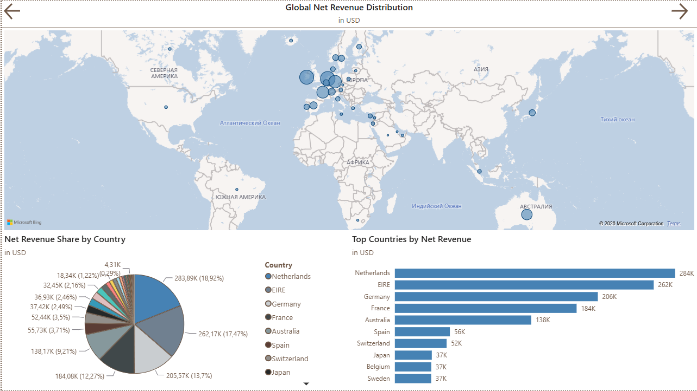

# cross-border-sales-powerbi-analysis

## Project Overview

This project presents an analytical dashboard built in **Microsoft Power BI** for exploring cross-border e-commerce sales using the **Online Retail** dataset.

The objective of the project is to identify geographical sales patterns, evaluate export performance, analyze customer purchasing behavior, and investigate factors affecting international revenue.

The dashboard was designed following business intelligence and data visualization best practices, including principles inspired by the **IBCS (International Business Communication Standards)** to improve readability, consistency, and decision-making.

## Business Problem

Companies operating in international e-commerce need to understand not only how much they sell, but also **where, when, and under what conditions** their international sales generate the strongest results.

The project addresses the following business questions:

- Which countries generate the highest international revenue?
- How is cross-border sales performance distributed geographically?
- How does international revenue change over time?
- Are there noticeable seasonal patterns in export activity?
- How does the number of international markets relate to revenue performance?
- Which markets demonstrate the strongest potential for further expansion?

The resulting Power BI dashboard provides an interactive analytical environment for exploring these questions.

## Objectives

The project aims to:

- Analyze international sales performance;
- Prepare and transform raw transactional data for analysis;
- Develop key business performance indicators using DAX;
- Explore the geographical distribution of international revenue;
- Identify leading export markets;
- Analyze monthly and weekday sales dynamics;
- Investigate the relationship between export geography and revenue;
- Build an interactive Power BI dashboard;
- Translate analytical findings into business-oriented conclusions and recommendations.

## Dataset

Online Retail Dataset (UCI Machine Learning Repository / Kaggle)

**Dataset characteristics**

- Initial dataset size: 541,909 transaction records;
- UK-based online retailer;
- Transactional sales data;
- Customer and product information;
- Invoice-level information;
- Quantity and unit price data;
- Customers from multiple countries;
- Time period: December 2010 - December 2011.

For the purposes of this project, the dataset was cleaned and transformed in **Power Query** before being analyzed in **Power BI**.

## Tools & Technologies

### Data Preparation
- Power Query

### Data Analysis & Modeling
- Microsoft Power BI
- DAX
- Data Modeling

### Visualization
- Interactive Power BI Dashboards
- KPI Cards
- Time-Series Analysis
- Geographic Visualization
- Scatter Plot Analysis

### Design
Business Intelligence reporting principles
IBCS-inspired visualization principles
Data storytelling

## Analytical Workflow

The project follows the following analytical workflow:

```text
Raw Transactional Data
        ↓
Data Cleaning & Preparation
        ↓
Power Query Transformation
        ↓
Power BI Data Model
        ↓
DAX Measures & KPI Calculation
        ↓
Interactive Dashboard Development
        ↓
Analytical Findings


## Dashboard Preview

### Market Overview


This page provides a high-level overview of export performance.

Main elements:

- KPI cards
- Monthly Net Export trend
- Monthly Average Cross-Sell Check
- Business performance overview

### Regional Analysis



This dashboard focuses on geographical sales distribution.

It includes:

- Global revenue map
- Revenue share by country
- Top exporting countries
- Geographic comparison of international markets

### Sales Factors


This page investigates relationships between export activity and business performance.

It includes:

- Scatter plot with exploratory relationship analysis
- Revenue by weekday
- Interactive month filter
- Interactive weekday filter

# Key Performance Indicators

The dashboard calculates several business metrics.

**| KPI | Description |**
| Net Revenue | Total international revenue |
| Export | Gross export value |
| Net Export | Export excluding returns |
| Average Cross-Sell Check | Average transaction value |
| Average Daily Export Orders | Average number of export orders per day |
| Unique Export Countries | Number of active export destinations |

# Repository Structure

cross-border-sales-analysis
│
├── OnlineRetail_dashboards.pbix
├── README.md
│
└── images
    ├── overview.png
    ├── regional.png
    └── factors.png


# Dashboard Pages


## 1. Market Overview

The **Market Overview** dashboard provides a high-level summary of international sales performance and key business indicators.

Its purpose is to help users quickly understand the overall state of export activity before moving to more detailed analysis.

### Business Value

This dashboard allows decision-makers to:

- monitor export performance over time;
- identify seasonal trends;
- evaluate overall business growth;
- quickly assess the health of international sales.


## 2. Regional Analysis

The **Regional Analysis** dashboard focuses on the geographical distribution of international revenue.

It helps to identify the most valuable export markets and compare country-level performance.

### Business Value

The dashboard supports strategic decisions by allowing users to:

- identify the strongest international markets;
- compare country performance;
- evaluate export diversification;
- discover opportunities for market expansion.


## 3. Sales Factors

The **Sales Factors** dashboard explores relationships between export activity and sales performance.

It combines interactive filtering with statistical visualization to investigate possible business patterns.

### Business Value

This dashboard helps answer questions such as:

- Is higher geographical diversification associated with higher revenue?
- Which weekdays generate the highest average revenue?
- How do seasonal changes influence export performance?

The analysis is exploratory and is intended to identify patterns and relationships that may require further statistical investigation.

### Key DAX Measures Examples

To calculate business performance metrics accurately, the following DAX measures were implemented:

**Net Revenue:**
Net_Revenue = CALCULATE(
    [Total_Revenue],
    'Final_OnlineRetail'[Quantity] > 0,
    'Final_OnlineRetail'[UnitPrice] > 0,
    NOT('Final_OnlineRetail'[StockCode] IN {"POST", "DOT", "M", "BANK CHARGES"})
)

**Average Cross-Sell Check:**
Avg_Check_(Cross) = 
CALCULATE(
    DIVIDE(
        [Net_Revenue], 
        DISTINCTCOUNT('Final_OnlineRetail'[InvoiceNo])
    ),
    'Final_OnlineRetail'[Country] <> "United Kingdom",
    'Final_OnlineRetail'[Quantity] > 0
)

# Key Analytical Findings

The analysis revealed several important business observations:

- International revenue is highly concentrated in several European countries.
- The Netherlands and EIRE dominate international sales, generating **$284K** and **$262K** in Net Revenue respectively.
- Monthly sales show strong cyclical fluctuations, peaking in October 2011 at **$191K** and experiencing a sharp seasonal drop in April down to **$49K**.
- Higher geographical diversification is generally associated with increased daily revenue.
- Revenue differs across weekdays, indicating possible operational and customer behavior patterns.
- Interactive filtering enables flexible exploration of seasonal effects and export activity.

# Business Implications

Based on the analytical findings:

## Strengthen key international markets

The strongest international markets should receive focused attention in marketing, customer retention, and logistics strategies.

## Reduce geographic concentration risk

The concentration of international revenue in a limited number of countries may create dependency on specific markets.

Expanding into additional markets could potentially improve geographic diversification and reduce concentration risk.

## Consider seasonality in planning

The observed monthly fluctuations suggest that inventory, marketing, and logistics planning should account for seasonal changes in international demand.

## Investigate market expansion opportunities

Countries with existing sales activity but lower revenue contribution could be analyzed further to identify opportunities for targeted growth.

## Further investigate geographic diversification

The observed relationship between the number of markets and revenue may justify additional research into whether expanding the international customer base can contribute to sustainable revenue growth.


# Skills Demonstrated

This project demonstrates practical experience with:

- Data cleaning and preparation using Power Query;
- Working with large transactional datasets;
- Power BI dashboard development;
- DAX measure creation;
- KPI design and calculation;
- Data visualization;
- Geographic sales analysis;
- Time-series and seasonal analysis;
- Exploratory relationship analysis;
- Interactive filtering and dashboard navigation;
- Business-oriented data storytelling;
- IBCS-inspired dashboard design principles;
- Translating analytical findings into business implications.


# How to Use

1. Download the repository.
2. Open **OnlineRetail_dashboards.pbix** using Microsoft Power BI Desktop.
3. Refresh the data if necessary.
4. Navigate through the three dashboard pages.
5. Use slicers to interact with the visualizations.
**Note:** The original dataset is not included in this repository. The project is provided primarily as a portfolio demonstration of the Power BI analytical workflow and dashboard development process.

# Future Improvements

Possible future enhancements include:

- Adding forecasting models for export revenue;
- Implementing customer segmentation;
- Creating product-level profitability analysis;
- Building executive dashboards with drill-through functionality;
- Publishing the report to Power BI Service.


# Project Highlights

- 541K+ initial transaction records;
- 397K+ records in the final analytical dataset;
- End-to-end data preparation using Power Query;
- Custom DAX-based KPI calculations;
- Three interactive Power BI dashboard pages;
- Geographic and seasonal sales analysis;
- Exploratory analysis of international sales relationships;
- Business-oriented analytical conclusions;
- IBCS-inspired visualization principles.


# Repository Contents

| File | Description |
|------|-------------|
| OnlineRetail_dashboards.pbix | Power BI dashboard |
| README.md | Project documentation |
| images/ | Dashboard screenshots |


# About the Author

This project was developed as part of my professional portfolio in Business Intelligence and Data Analytics.

My interests include:

- Business Intelligence
- Data Analytics
- Power Query
- DAX
- Power BI
- SQL
- Excel
- Data Visualization
- Dashboard Design

I am currently seeking opportunities as a **Junior Data Analyst / BI Analyst**, where I can apply analytical thinking, data visualization, and business intelligence skills to solve real-world business problems.
My main interests include transforming raw data into actionable insights, developing BI dashboards, and analyzing business performance.


## Contact

GitHub: **https://github.com/PavNikita**


## License

This project is intended for educational and portfolio purposes.
