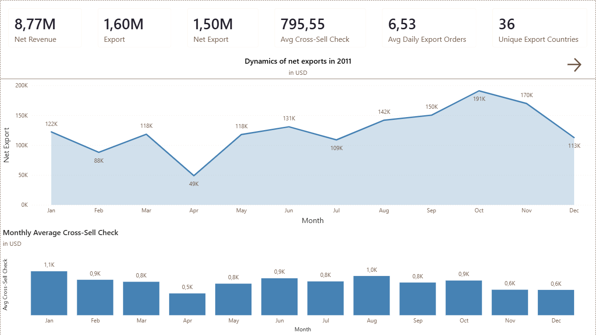
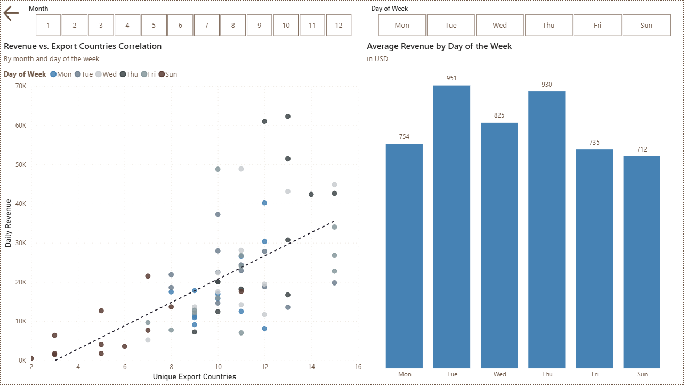

# cross-border-sales-powerbi-analysis

## Project Overview

This project presents an analytical dashboard built in **Microsoft Power BI** for exploring cross-border e-commerce sales using the **Online Retail** dataset.

The objective of the project is to identify geographical sales patterns, evaluate export performance, analyze customer purchasing behavior, and investigate factors affecting international revenue.

The dashboard was designed following business intelligence and data visualization best practices, including principles inspired by the **IBCS (International Business Communication Standards)** to improve readability, consistency, and decision-making.

## Business Problem

Cross-border e-commerce has become one of the fastest-growing segments of international trade. Companies selling products worldwide need to understand:

- Which countries generate the highest revenue;
- How export activity changes over time;
- What factors influence international sales;
- Which markets demonstrate the highest business potential.

This dashboard provides an interactive analytical solution for answering these business questions.

## Objectives

The project aims to:

- Analyze international sales performance;
- Explore the geographical distribution of revenue;
- Identify leading export markets;
- Investigate monthly sales dynamics;
- Analyze relationships between export geography and revenue;
- Calculate and visualize key business indicators;
- Build an interactive dashboard for business decision support.

## Dataset

Online Retail Dataset (UCI Machine Learning Repository / Kaggle)

**Dataset characteristics**

- Transactions of a UK-based online retailer
- Period: December 2010 – December 2011
- More than 500,000 sales records
- Customers from dozens of countries
- Sales, quantity, invoice, customer and product information

For the purposes of this project, the dataset was cleaned and transformed in **Power Query** before being analyzed in **Power BI**.

## Tools & Technologies

- Microsoft Power BI
- Power Query
- DAX
- Data Modeling
- Interactive Dashboards
- Business Intelligence
- Data Visualization
- IBCS-inspired dashboard design

## Dashboard Preview

### Market Overview

This page provides a high-level overview of export performance.

Main elements:

- KPI cards
- Monthly Net Export trend
- Monthly Average Cross-Sell Check
- Business performance overview

### Regional Analysis

This dashboard focuses on geographical sales distribution.

It includes:

- Global revenue map
- Revenue share by country
- Top exporting countries
- Geographic comparison of international markets

### Sales Factors

This page investigates relationships between export activity and business performance.

It includes:

- Scatter plot correlation analysis
- Revenue by weekday
- Interactive month filter
- Interactive weekday filter

# Key Performance Indicators

The dashboard calculates several business metrics.

**| KPI | Description |**
| Net Revenue | Total international revenue |
| Export | Gross export value |
| Net Export | Export excluding returns |
| Average Cross-Sell Check | Average transaction value |
| Average Daily Export Orders | Average number of export orders per day |
| Unique Export Countries | Number of active export destinations |

# Repository Structure

cross-border-sales-analysis
│
├── OnlineRetail_dashboards.pbix
├── README.md
│
└── images
    ├── overview.png
    ├── regional.png
    └── factors.png

# Dashboard Pages

## 1. Market Overview

The **Market Overview** dashboard provides a high-level summary of international sales performance and key business indicators.

Its purpose is to help users quickly understand the overall state of export activity before moving to more detailed analysis.

### Business Value

This dashboard allows decision-makers to:

- monitor export performance over time;
- identify seasonal trends;
- evaluate overall business growth;
- quickly assess the health of international sales.

## 2. Regional Analysis

The **Regional Analysis** dashboard focuses on the geographical distribution of international revenue.

It helps to identify the most valuable export markets and compare country-level performance.

### Business Value

The dashboard supports strategic decisions by allowing users to:

- identify the strongest international markets;
- compare country performance;
- evaluate export diversification;
- discover opportunities for market expansion.

## 3. Sales Factors

The **Sales Factors** dashboard explores relationships between export activity and sales performance.

It combines interactive filtering with statistical visualization to investigate possible business patterns.

### Business Value

This dashboard helps answer questions such as:

- Does selling to more countries increase revenue?
- Which weekdays generate the highest average revenue?
- How do seasonal changes influence export performance?

### Key DAX Measures Examples

To calculate business performance metrics accurately, the following DAX measures were implemented:

**Net Revenue:**
Net_Revenue = CALCULATE(
    [Total_Revenue],
    'Final_OnlineRetail'[Quantity] > 0,
    'Final_OnlineRetail'[UnitPrice] > 0,
    NOT('Final_OnlineRetail'[StockCode] IN {"POST", "DOT", "M", "BANK CHARGES"})
)

**Average Cross-Sell Check:**
Avg_Check_(Cross) = 
CALCULATE(
    DIVIDE(
        [Net_Revenue], 
        DISTINCTCOUNT('Final_OnlineRetail'[InvoiceNo])
    ),
    'Final_OnlineRetail'[Country] <> "United Kingdom",
    'Final_OnlineRetail'[Quantity] > 0
)

# Key Analytical Insights

The analysis revealed several important business observations:

- International revenue is highly concentrated in several European countries.
- The Netherlands and EIRE dominate international sales, generating **$284K** and **$262K** in Net Revenue respectively.
- Monthly sales show strong cyclical fluctuations, peaking in October 2011 at **$191K** and experiencing a sharp seasonal drop in April down to **$49K**.
- Higher geographical diversification is generally associated with increased daily revenue.
- Revenue differs across weekdays, indicating possible operational and customer behavior patterns.
- Interactive filtering enables flexible exploration of seasonal effects and export activity.

# Skills Demonstrated

This project demonstrates practical experience with:

- Data cleaning using Power Query;
- Data modeling in Power BI;
- DAX measures and calculated metrics;
- Interactive dashboard development;
- Business KPI design;
- Geographic data visualization;
- Correlation analysis;
- Dashboard design based on IBCS-inspired principles;
- Business-oriented data storytelling.

# How to Use

1. Download the repository.
2. Open **OnlineRetail_dashboards.pbix** using Microsoft Power BI Desktop.
3. Refresh the data if necessary.
4. Navigate through the three dashboard pages.
5. Use slicers to interact with the visualizations.

# Future Improvements

Possible future enhancements include:

- Adding forecasting models for export revenue;
- Implementing customer segmentation;
- Creating product-level profitability analysis;
- Building executive dashboards with drill-through functionality;
- Publishing the report to Power BI Service.

# Project Highlights

- Interactive Power BI dashboards
- Data transformation using Power Query
- DAX-based KPI calculations
- Business Intelligence reporting
- Geographical sales analysis
- Correlation analysis
- Professional dashboard design
- IBCS-inspired visualization principles

# Repository Contents

| File | Description |
|------|-------------|
| OnlineRetail_dashboards.pbix | Power BI dashboard |
| README.md | Project documentation |
| images/ | Dashboard screenshots |

# About the Author

This project was developed as part of my professional portfolio in Business Intelligence and Data Analytics.

My interests include:

- Business Intelligence
- Data Analytics
- Power BI
- SQL
- Excel
- Data Visualization
- Dashboard Design

I am currently seeking opportunities as a **Junior Data Analyst / BI Analyst**, where I can apply analytical thinking, data visualization, and business intelligence skills to solve real-world business problems.

## Contact

GitHub: **https://github.com/PavNikita**

## License

This project is intended for educational and portfolio purposes.
